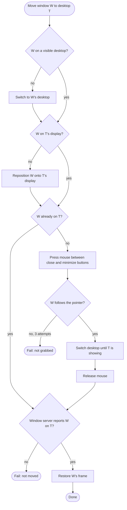

# macOS Workspace Manager

Menu-bar app that turns Mission Control desktops into named workspaces and keeps windows on the workspace they belong to.

- Name each desktop; the menu bar shows the current one.
- Every window belongs to the desktop you last put it on, by dragging it there or by sending it.
- When macOS shuffles windows (wake, display reconnect, reboot), the menu bar shows how many are displaced and one command puts them back.
- Send a window to a workspace from its title bar or from the keyboard.
- Jump to a workspace from a keyboard-driven list.
- In Mission Control, see the current workspace name in large characters and each named desktop labelled in the bar at the top.

Documentation: [supported use cases](docs/use-cases.md), [test plan](docs/test-plan.md).

## Usage

| Action | Default |
|---|---|
| Go to a workspace | `ctrl+alt+space`, then pick or press `1`–`9` |
| Send the focused window to a workspace | `ctrl+alt+shift+space` |
| Send any window to a workspace | `alt+shift` + right-click on its title bar |
| Restore displaced windows | `ctrl+alt+r` |
| Rename a desktop | Right-click (or Control-click) it in the menu or the workspace list; in Mission Control, right-click the large name or a desktop of the top bar |
| Rename the current desktop, keep the current layout, start at login, list the shortcuts | Menu-bar item |

Shortcuts are set in `~/Library/Application Support/WorkspaceManager/config.json` (menu: Open Configuration) and read at launch. An empty string disables a shortcut.

```json
{
  "shortcuts": {
    "switchWorkspace": "ctrl+alt+space",
    "sendWindow": "ctrl+alt+shift+space",
    "restoreWindows": "ctrl+alt+r"
  },
  "titleBarMenu": { "modifiers": "alt+shift", "height": 40 },
  "missionControlBanner": { "enabled": true, "desktopLabels": true }
}
```

## Requirements

- macOS 14 or later, System Integrity Protection left enabled. Developed and tested on macOS 26.6 only.
- **Accessibility** permission: moving windows, title-bar click, labels and right-click rename in Mission Control.
- **Screen Recording** permission: reading window titles on hidden desktops, needed to recognise windows after an app restart or reboot; without it they are tracked as new windows. Nothing is captured.
- Mission Control shortcuts **Move left a space** and **Move right a space** enabled (System Settings > Keyboard > Keyboard Shortcuts > Mission Control). Enabling **Switch to Desktop N** makes distant moves faster.

## Build and run

The app is ad-hoc signed: `make install` clears the previous permission grants and macOS asks for the two permissions again. Start at Login is only offered by the installed app.

```sh
make run        # from a terminal, using the terminal's permissions
make app        # build/WorkspaceManager.app
make install    # copy it to /Applications and start it
make status     # what the app sees: desktops, window counts, displaced windows
make test       # unit and read-only contract tests
make live-test  # switches desktops, moves a real TextEdit window, opens Mission Control; takes over the screen for a few seconds
```

## How it works

macOS has no public API for Spaces. With SIP enabled:

| Need | Mechanism |
|---|---|
| Desktops and their order, window membership | Private window-server read calls (`CGSCopyManagedDisplaySpaces`, `CGSCopySpacesForWindows`) |
| Switch desktop | The user's own Mission Control shortcuts, pressed synthetically |
| Move a window to a desktop | Synthetic title-bar drag while switching desktop. The private move calls are rejected by macOS for other apps' windows |
| Title-bar menu | Event tap on modifier + right-click; apps cannot extend each other's menus |
| Names over Mission Control | Undocumented Dock accessibility notifications signal open and close; a window marked stationary is not turned into a thumbnail. The desktops of the top bar are located through the Dock's accessibility tree, read ten times a second while Mission Control is open. Right-clicks on the labels are observed with a listen-only event tap, since AppKit's global event monitors receive nothing there |

Every synthetic step is checked against the window server, so an ignored key press or a failed grab is reported instead of leaving a window in the wrong place.



### Which workspace a window belongs to

The app observes all windows every two seconds.

- A window first seen on a desktop is homed there.
- A window that changes desktop is re-homed, unless the change is seen within 60 seconds of a wake or display change (notified by macOS, or seen as a different set of displays). Those windows are *displaced*: they keep their home and are listed in the menu.
- After an app restart or reboot, window IDs change. Windows are re-identified by app and title similarity; among identical titles, a window already on a matching home is preferred. A window whose title is unreadable is never matched. A boot is identified by `kern.bootsessionuuid`.
- Workspaces are keyed by the Space UUID, which survives reboots and display reconnection.

State is stored in `~/Library/Application Support/WorkspaceManager/state.json`.

### Code layout

| Target | Role |
|---|---|
| `Workspaces` | Domain: desktop layout, workspace names, window placements, re-identification. No system calls |
| `MacDesktop` | macOS adapter: reading Spaces and windows, switching desktop, moving windows |
| `MissionControlBanner` | Workspace names over Mission Control. Depends on no other target; a failure disables only this feature |
| `WorkspaceManager` | Menu-bar app: menus, shortcuts, title-bar click, persistence |

## Limitations

- A move takes over the pointer for about a second and visibly switches desktops; the app returns to the desktops that were showing.
- Not tracked: windows shown on all desktops, fullscreen and minimized windows.
- Windows without standard close and minimize buttons cannot be moved.
- In the Mission Control bar only desktops with a custom name are labelled. While the bar is collapsed a name longer than about twelve characters is truncated.
- The private read calls and the Dock notifications are undocumented and may change with a macOS release.
